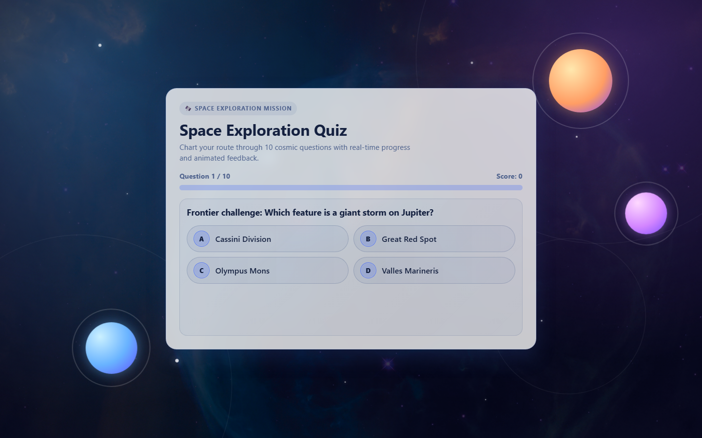

# Space Exploration Quiz

An interactive space-themed quiz experience with:

- 10 random questions per run (selected from a larger question base)
- Animated 2x2 answer layout (A/B/C/D)
- Correct/wrong feedback with distinct motion
- 3D flip-card learning view showing:
  - the question
  - all answer options
  - correct answer highlight
  - selected answer highlight
- Continue flow between questions
- Final score screen with emoji reaction
- Animated space scene (stars, comets, galaxies, parallax)

## Screenshot

## Run locally

This project can be opened directly as a static page:

1. Open `index.html` in your browser, or
2. Use any simple static server.

No build step or external dependency is required for the quiz page.

## Project structure

- `index.html`: Main standalone quiz app (UI, styling, logic)
- ASP.NET scaffold files (`Controllers`, `Views`, `wwwroot`, etc.): initial scaffold generated earlier in setup

## Customization notes

- Question content: update `questionFacts` in `index.html`
- Questions per game: update `QUIZ_LENGTH`
- Visual theme: tweak CSS variables in `:root`

## License

No license file is currently included.
